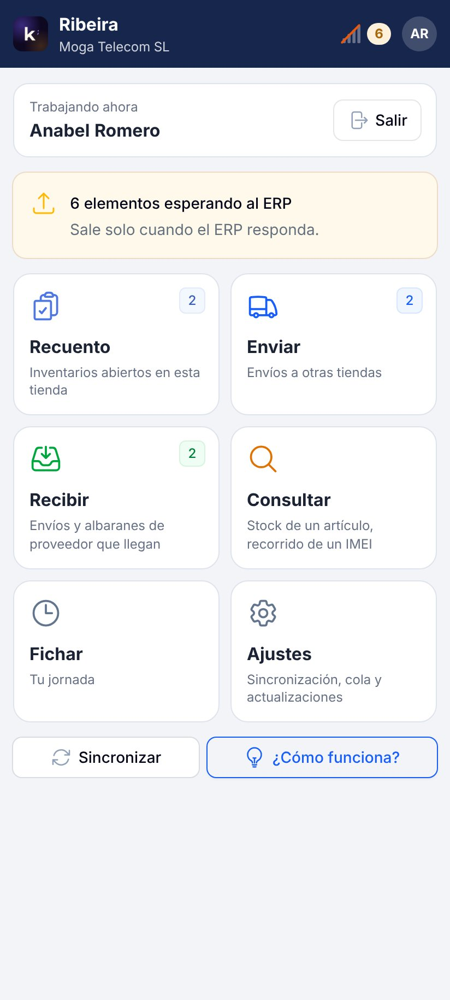
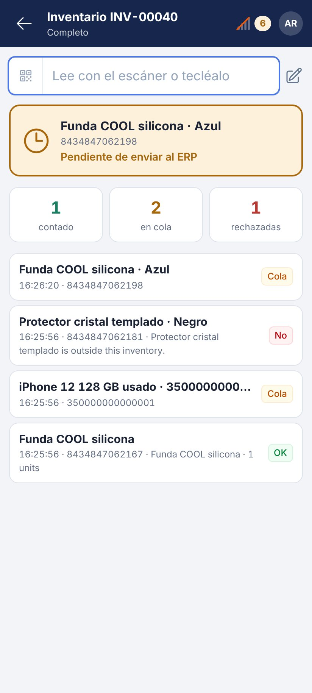
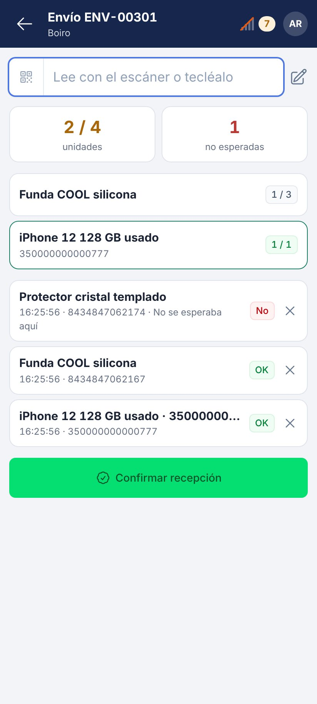
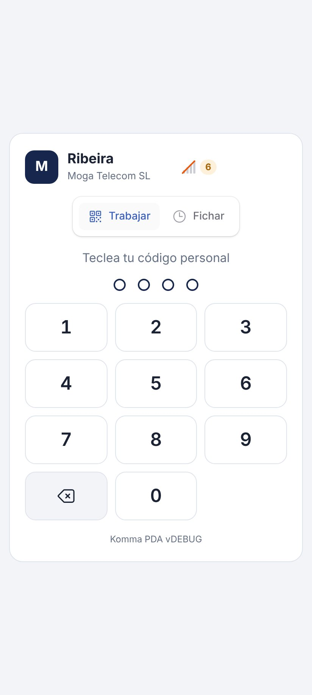
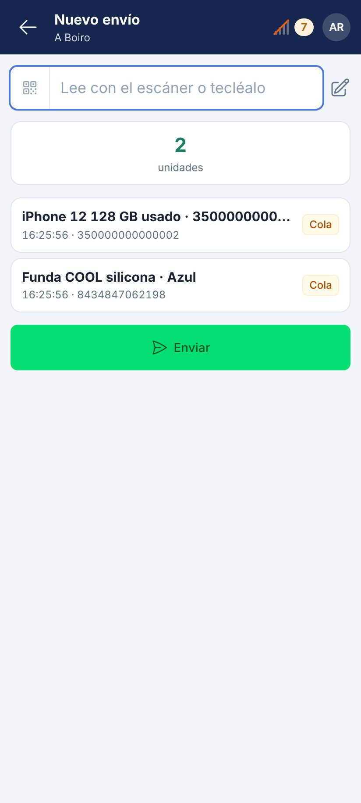
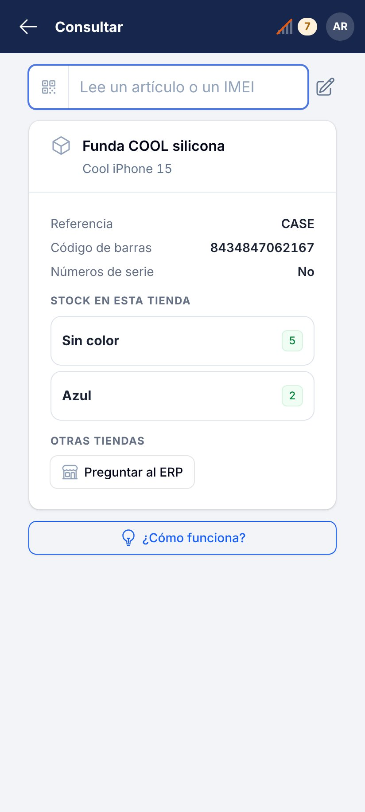

# Komma PDA

The warehouse and store handheld of **Komma ERP**. It counts inventories,
prepares shipments to other stores, checks what arrives from other stores and
from suppliers, looks up stock and IMEIs and clocks employees in and out. One
read per unit, with the handheld's laser or its camera, and it keeps working
when the network drops.

## Download

| System | Download |
| --- | --- |
| **Android 13 or later** | [Latest version](https://github.com/komma-softhouse/komma-pda-releases/releases/latest): the `.apk` file |

Every published version is listed under
[Releases](https://github.com/komma-softhouse/komma-pda-releases/releases).
Each version also carries its `.sha256` file to check that the `.apk` has not
been altered. The easiest way is to download it from the ERP itself, in
**System → Store apps**, which always links the latest version.

  
  
  

## What it does

- **Inventory counts.** The office opens the inventory in the ERP and the
  handheld reads every unit: by IMEI or serial number when it has one, by
  barcode when it does not. Every read shows green, amber (waiting for the ERP)
  or red with the reason.
- **Shipments to other stores.** Start a shipment or open one the office
  prepared, read what goes in the box and send it. Without network everything
  is kept and leaves in order when the connection comes back.
- **Receiving shipments.** A shipment from another store is checked unit by
  unit; what is missing or left over reaches the office noted on the shipment.
- **Receiving supplier delivery notes.** The boxes are checked against the
  delivery note and, if the office did not type the IMEIs, they are read on
  arrival, unit by unit.
- **Look up.** Stock of an article in this store by colour, stock in the other
  stores and the whole path of an IMEI.
- **Clocking.** Every employee clocks in and out with their personal code, even
  without network.
- **Without network.** Everything read stays on the handheld and reaches the
  ERP in order; the bars at the top say whether the ERP answers and how many
  items are waiting.
- **Updates itself.** From **Settings → Updates**, without Google Play.

## Install

1. On the handheld, open the
   [latest version](https://github.com/komma-softhouse/komma-pda-releases/releases/latest)
   and download the `.apk` file.
2. Open it. If Android asks for permission to install apps from this source,
   allow it for the browser and go back.
3. Tap **Install**. Komma PDA appears in the app drawer.

## Getting started

1. **In the ERP**, go to **Tills and printing → Devices → Pair a handheld** and
   choose the store or warehouse. A code and its QR appear, valid for 15
   minutes and for a single use.
2. **On the handheld**, tap **Read the QR of the ERP** and point at the QR (or
   type the ERP address and the code), name this handheld and tap **Pair**. The
   articles, stores, employees, the stock of its store and the pending work are
   downloaded.
3. **Sign in with your personal code.** Only employees with handheld access in
   the ERP can sign in.
4. **Laser scanner:** if the handheld has a built-in scanner, set it to
   keyboard mode with Enter as suffix. The camera works on any phone.

  
  
  

## Requirements

- Android 13 or later.
- Rear camera, or a built-in laser scanner in keyboard mode.
- Wi-Fi or mobile data to talk to the company's ERP. Counting, shipping and
  clocking work without network; opening an incoming shipment or delivery note
  needs the ERP once.

## Updates

In **Settings → Updates** tap **Check for updates**. If there is a new version,
**Download and install** fetches it, checks that it arrived complete and opens
the Android installer. The first time, Android asks to allow installing from
Komma PDA. The handheld keeps its pairing and everything still waiting to be
sent.

## If something fails

When the handheld meets an unexpected error it shows an incident code and a
button to report it. The report reaches Komma with the code, the version and
the screen, never stock or employee data. If you call support, have the code at
hand.

## Support

Komma SoftHouse · [kommasofthouse.com](https://kommasofthouse.com) · info@kommasofthouse.com
